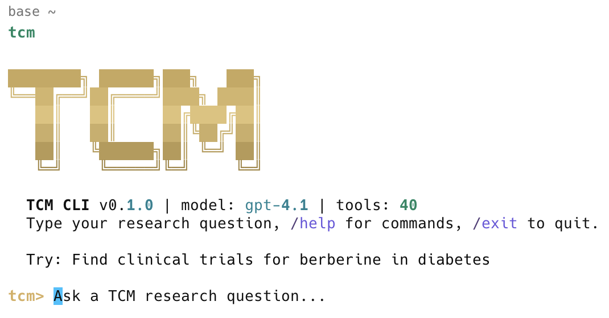

# TCM Studio & CLI (`tcm-cli` v0.2.0)


**Multimodal Traditional Chinese Medicine Studio & Autonomous Research Agent — from Classical Canon to Molecular Graph.**

`tcm-cli` unifies classical **Four Examinations (`四诊合参`: Inspection `望`, Auscultation `闻`, Inquiry `问`, Palpation `切`)** with **50+ computational pharmacology & clinical safety tools**, an interactive **Multimodal TCM Studio web workbench** (`tcm studio`), and unified routing across **60+ SOTA foundation models** from 15 cloud and local providers.

---

## Highlights in v0.2.0

- **Multimodal TCM Studio (`tcm studio`)** — Full interactive 4-workspace web application & REST API engine for optical CIE-$L^*a^*b^*$ tongue diagnosis (`望舌象`), crude herb decoction piece authentication (`饮片鉴别`), classical prescription OCR & Eastern Han metrology conversion (`古今方笺换算`), force-directed **Formula → Herb → Compound → Target → KEGG Pathway** network pharmacology, SVG meridian acupoint atlas, and multi-step agent synthesis.
- **50 Computational TCM Tools Across 15 Categories** — Spanning `diagnostics` (Four Examinations), `herbs`, `formulas`, `syndromes`, `compounds`, `pharmacology`, `interactions` (`十八反/十九畏` + CYP450 herb–drug checks), `safety`, `acupuncture` (28 WHO meridian points + pregnancy-safe filtering), `classics` (7 classical canons including *Huangdi Neijing*, *Shanghan Lun*, *Jin Gui Yao Lue*, *Shennong Bencao Jing*, and *Bencao Gangmu*), `meridians`, `literature`, `modern`, `data_api`, and `code`.
- **60+ SOTA Models Across 15 Providers** — Native multimodal (`vision`, `audio`, `video`, `pdf`, `thinking`) support for **Anthropic** (`claude-fable-5-2`, `claude-opus-5-5`, `claude-sonnet-5-5`), **OpenAI** (`gpt-6-astra`, `gpt-6.1-sol`, `gpt-6.1-terra`, `gpt-rosalind-research`), **Google Gemini** (`gemini-3.6-flash`, `gemini-3.1-pro-preview`, `gemini-2.5-pro`), **DeepSeek** (`deepseek-v4-pro`, `deepseek-v4.1-flash`), **Qwen** (`qwen3.8-max`, `qwen-vl-max`), **Zhipu GLM** (`glm-5.3`, `glm-4v-plus`), **Moonshot Kimi** (`kimi-k3.1-pro`), **MiniMax** (`minimax-m3`), **xAI** (`grok-4.8`), **Mistral** (`pixtral-large-latest`), **Groq**, **Cohere**, **Together**, **OpenRouter**, and **Local Ollama** (`ollama/medgemma:27b`, `ollama/huatuogpt-vision:7b`, `ollama/qwen3:32b`).
- **Multimodal CLI & REPL** — Attach clinical tongue photos, herb specimens, audio recordings, or PDFs directly via `tcm -i tongue.jpg "..."` or `/attach` inside the interactive terminal.
- **Bilingual Throughout (`en` | `zh` | `bi`)** — Seamless English, Chinese (`中文`), and aligned Bilingual research synthesis.

---

## Quick Start

### Installation

```bash
# Quick install script (detects pipx, uv, or pip)
curl -fsSL https://raw.githubusercontent.com/tigerneil/tcm-cli/main/install.sh | bash

# Or install with pipx (recommended)
pipx install tcm-cli

# Or install with pip + optional scientific & vision stacks
pip install "tcm-cli[vision]"      # High-res JPEG/WebP Pillow support
pip install "tcm-cli[chemistry]"   # RDKit molecular descriptors
pip install "tcm-cli[analysis]"    # scikit-learn, scipy, seaborn
pip install "tcm-cli[all]"         # Full scientific + vision suite
```

### Launch Multimodal TCM Studio

```bash
# Launch local Studio web workbench & REST API at http://127.0.0.1:8765/studio
tcm studio --open

# Launch with a specific SOTA multimodal model
tcm studio --port 8765 --model claude-opus-5-5

# Air-gapped / private hospital mode using local Ollama medical VLM
tcm studio --model ollama/huatuogpt-vision:7b
```

> **Note:** Even before configuring an LLM API key, `tcm studio` works out of the box with deterministic Python tools, quantitative CIE-$L^*a^*b^*$ tongue/herb colorimetry, multi-layer network pharmacology graphs, and offline clinical safety validation.

### Multimodal CLI Examples

```bash
# Interactive terminal session
tcm

# Optical tongue diagnosis (望舌象) with SOTA Vision model
tcm -i tongue.jpg --model claude-opus-5-5 --lang bi \
  "Analyze tongue colorimetry, Eight Principles, and recommend a classical formula"

# Authenticate a crude herb slice (饮片鉴别)
tcm -i huangqi_slice.jpg --model qwen-vl-max \
  "Verify macroscopic markers, potential adulterants, and processing specs"

# Classical prescription & Eastern Han metrology conversion
tcm "Parse 桂枝三两 芍药三两 甘草二两炙 生姜三两 大枣十二枚 using Eastern Han weights and check safety"

# Network pharmacology & herb-drug safety
tcm --model gpt-rosalind-research \
  "Build network pharmacology for 补中益气汤 and check interactions with Warfarin"

# Task-aware SOTA model routing
tcm model recommend tongue_vision
tcm model list --modality vision
```

---

## Architecture & Workspaces



### Studio Workspaces (`docs/studio.html` & `tcm studio`)

1. **Workspace I — Multimodal Four-Examinations Lab (`四诊多模态实验台`)**: Drag-and-drop tongue/herb/prescription imaging with live CIE $L^*a^*b^*$ somatotopy (`舌尖心肺`, `舌中脾胃`, `舌边肝胆`, `舌根肾`), pharmacognosy authentication, multi-era dosage conversion, and 28-pulse (`二十八脉`) synthesis.
2. **Workspace II — Formula Composer & Network Pharmacology (`方剂配伍与网络药理`)**: Interactive force-directed `Formula → Herb (君臣佐使) → Compound → Protein Target → KEGG Pathway` graph with ADMET metrics and real-time `十八反 / 十九畏` + CYP450 herb–drug safety screening.
3. **Workspace III — Materia Medica, Meridians & Classics (`本草・经穴・典籍`)**: Anterior/posterior SVG human meridian atlas with clickable WHO acupoints, Materia Medica monographs, and searchable clauses across 7 classical TCM canons.
4. **Workspace IV — SOTA Agent Console (`智能体研究终端`)**: Multi-step `Plan → Tool Execution → Grounded Bilingual Synthesis` terminal with Markdown session export.

---

## 50 Domain Tools (15 Modules)

| Module | Representative Tools & Capabilities |
| --- | --- |
| **`diagnostics`** | `tongue_analyze` (CIE $L^*a^*b^*$ + 11 archetypes), `herb_identify` (13 decoction monographs + adulterants), `prescription_parse` (Han/Ming/Modern metrology), `four_examinations` (28 pulses `二十八脉` fusion) |
| **`acupuncture`** | `point_lookup` (28 WHO points across 14 channels), `by_meridian`, `protocol` (with `pregnancy_safe` point substitution) |
| **`classics`** | `search`, `clause_lookup`, `herb_monograph` (*Huangdi Neijing*, *Shanghan Lun*, *Jin Gui Yao Lue*, *Shennong Bencao Jing*, *Wenbing Tiaobian*, *Pi Wei Lun*, *Bencao Gangmu*) |
| **`herbs`** | Materia Medica lookup, `性味归经` classification, meridian & category filtering, key compounds |
| **`formulas`** | Classical formula search, `君臣佐使` structural composition, clinical modifications |
| **`syndromes`** | Pattern lookup, symptom-to-syndrome differentiation, treatment principles |
| **`compounds`** | Phytochemical search, Lipinski/ADMET profiling, protein target identification |
| **`pharmacology`** | Multi-layer herb–compound–target network construction, KEGG/GO pathway enrichment |
| **`interactions`** | `十八反` / `十九畏` herb–herb incompatibility checks, Western drug CYP/anticoagulant interactions |
| **`safety`** | Toxicity profiling (`附子` aconitine boiling rules), pregnancy safety, dosage validation |
| **`meridians`** | Twelve Regular Channels & Five-Element (`五行`) correspondences |
| **`literature`** | PubMed search, systematic review & meta-analysis discovery |
| **`modern`** | ClinicalTrials.gov search, ICD-10 disease mapping, modern evidence grading |
| **`data_api`** | Live connectors to TCMSP, UniProt, STRING, KEGG, ClinicalTrials.gov, Open Targets |
| **`code`** | Sandboxed Python scientific computation (experimental) |

Inspect all registered tools:

```bash
tcm tool list
```

---

## SOTA Providers & Authentication

Configure one or more providers via `tcm keys` or environment variables:

```bash
tcm setup                          # Interactive wizard
tcm keys                           # View key status across all 15 providers
tcm keys set -p anthropic          # Claude Fable 5.2, Opus 5.5, Sonnet 5.5, Haiku 5.5
tcm keys set -p openai             # GPT-6 Astra, 6.1 Sol, 6.1 Terra, GPT-Rosalind
tcm keys set -p google             # Gemini 3.6 Flash, 3.1 Pro, 2.5 Pro
tcm keys set -p deepseek           # DeepSeek V4 Pro, V4.1 Flash (Vision), R1
tcm keys set -p qwen               # Qwen 3.8 Max, Qwen-VL Max (Ancient OCR & Tongue)
tcm keys set -p glm                # Zhipu GLM-5.3, GLM-4V Plus
tcm keys set -p kimi               # Moonshot Kimi K3.1 Pro, K3
tcm keys set -p xai                # xAI Grok 4.8, Grok 4 Vision
```

Switch models anytime via CLI or REPL (`/model`):

```bash
tcm model set claude-opus-5-5
tcm model set gpt-6.1-terra
tcm model set gemini-3.6-flash
tcm model set deepseek-v4.1-flash
tcm model set qwen-vl-max
tcm model set ollama/medgemma:27b
```

---

## Documentation

- **[Multimodal TCM Studio Guide](docs/STUDIO.md)** — Workspaces, CIE-$L^*a^*b^*$ tongue colorimetry, historical metrology, and REST API endpoints
- **[SOTA Models & Multimodal Routing](docs/MODELS.md)** — Full 60+ model catalog, modalities, and task recommendations
- **[Providers & API Keys](docs/PROVIDERS.md)** — Environment variables and base URLs for all 15 providers
- **[Language Modes](docs/LANGUAGE.md)** — English (`en`), Chinese (`zh`), and Bilingual (`bi`) output modes
- **[Official Website (`docs/index.html`)](docs/index.html)** & **[Interactive Studio App (`docs/studio.html`)](docs/studio.html)**
- **[Changelog](CHANGELOG.md)**

---

## Contributing & Testing

```bash
git clone https://github.com/tigerneil/tcm-cli.git
cd tcm-cli
pip install -e ".[dev]"
pytest
```

## License

MIT
